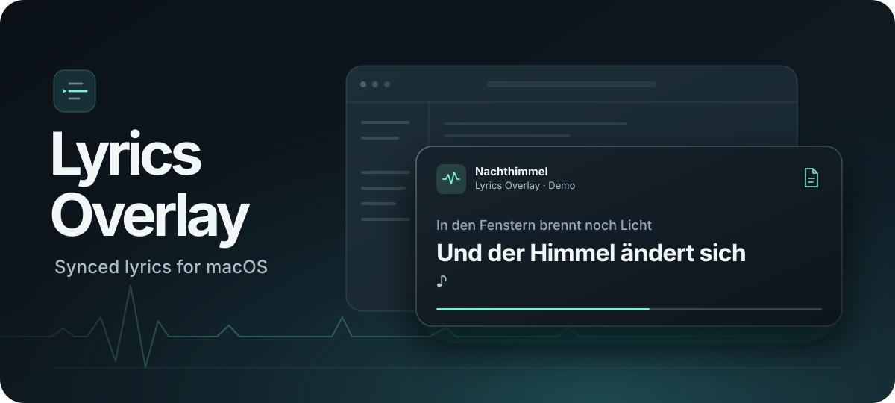

<p align="center">
  
</p>

# Lyrics Overlay

**Synced lyrics for Spotify and Apple Music, above the apps you already use.**

Keep a single lyric line on screen or show the lines around it. If a song is early or late, tune it once. If the lyrics are missing, import an LRC file or time your own in the editor.

[**Try it on macOS**](#try-it-on-macos) · [Use your own lyrics](#use-your-own-lyrics) · [Troubleshooting](#troubleshooting)

| At a glance | For each song | Your own lyrics |
| --- | --- | --- |
| Switch between one line, current and next, or surrounding lines. Drag the overlay to a corner and let clicks pass through. | Nudge the timing in 0.25-second steps. Lyrics Overlay remembers the adjustment the next time that song plays. | Import a timed file or paste your lyrics and stamp each line as the song plays. Saved lyrics work offline. |

## Try it on macOS

Requires macOS 13 or later, the Apple Command Line Tools, and the desktop version of Spotify or Apple's Music app for live playback. The example below launches a built-in demo without a player or network requests.

```sh
git clone https://github.com/JulianRudrich/LyricsOverlay.git
cd LyricsOverlay
bash build-app.sh
open "Lyrics Overlay.app" --args --demo
```

Quit the demo and open `Lyrics Overlay.app` again for live playback. Play a song and approve the macOS Automation prompt for the player. Spotify and Apple Music are read locally. Lyrics Overlay uses neither player API keys nor a separate login.

- **Choose a player** in **Song & Timing**. Automatic mode follows an active player. You can also lock the source to Spotify or Apple Music.
- **Open settings** with the waveform button in the overlay or a left-click on the menu-bar icon.
- **Move or hide the overlay** from the menu-bar icon's context menu. **⌥ ⇧ L** toggles visibility from any app.

The source build is ad-hoc signed. For a prebuilt copy, download the universal ZIP artifact from a successful [macOS build](../../actions/workflows/ci.yml). GitHub requires sign-in for workflow artifacts. The [0.1.0 release](../../releases/tag/v0.1.0) is the earlier Spotify-only preview.

## Use your own lyrics

1. Play the song you want to edit and open **Song & Timing**.
2. Choose **LRC importieren** for an existing file, or **Lyrics bearbeiten** to paste or edit the text.
3. In the editor, use **Zeitstempel setzen** or **⇧⌘T** on the current line as you listen. Save once the text has timestamps.
4. Use the **±0.25 s** buttons if the whole song needs a small timing correction. Positive values bring the text forward.

Own lyrics take precedence for the current recording. You can remove them, reset timing independently, or disable online search and use only your files. Imports support UTF-8 LRC up to 512 KB per track. An empty timed line marks an instrumental break.

## Troubleshooting

- **The player is open, but the overlay cannot read it.** Check **System Settings → Privacy & Security → Automation** and enable the player for Lyrics Overlay.
- **Apple Music is playing, but the track is unavailable.** On some macOS versions, Music can fail to expose playback metadata for songs outside your library. Add the track to your library and play it from there. [Apple Developer Forums](https://developer.apple.com/forums/thread/798267)
- **A song has no synced lyrics.** Try again from the overlay, or import your own LRC. Online results depend on availability in LRCLIB and a match to the recording.
- **Clicks go through the overlay.** Right-click the menu-bar icon and disable **Klicks durchlassen** before moving it or opening settings from it.

## Privacy

Online lookup sends track title, artist, album when available, and duration to LRCLIB over HTTPS. The results cache stays in memory. Song offsets are stored in macOS preferences, and your own lyrics stay in `~/Library/Application Support/Lyrics Overlay/LRC`. The app does not upload your edits. [LRCLIB](https://lrclib.net/)

## Development

```sh
swift build
swift run LyricsCoreChecks
bash build-release.sh "$(cat VERSION)"
```

The [macOS workflow](../../actions/workflows/ci.yml) builds the app, runs the core checks, and verifies the universal arm64 and x86_64 preview archive. Test playback, Automation permission, and overlay behavior with both players on a Mac before distributing a build. See the [contribution guide](CONTRIBUTING.md).

Created by [Julian Rudrich](https://github.com/JulianRudrich). The code is licensed under [MIT](LICENSE). Song lyrics belong to their respective rights holders.
