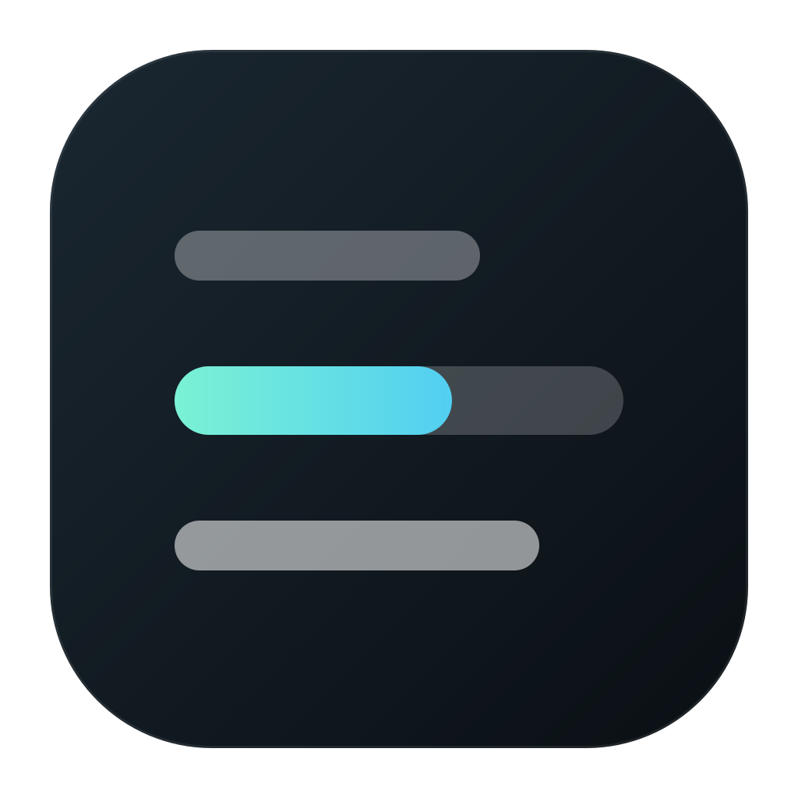
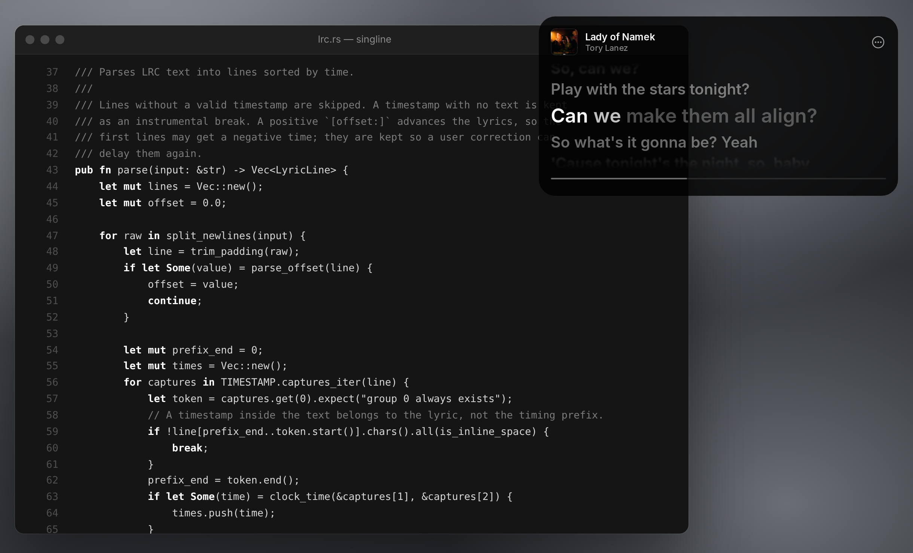
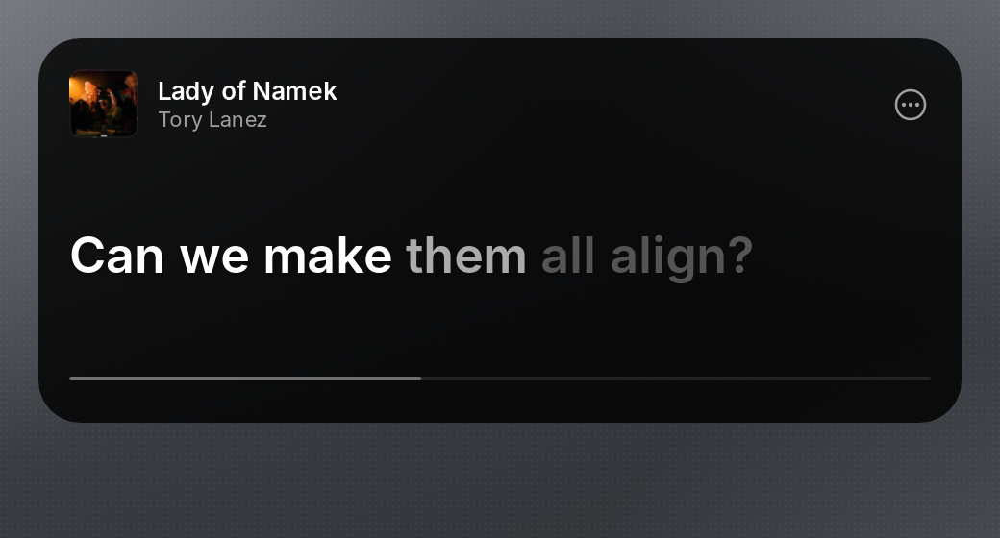
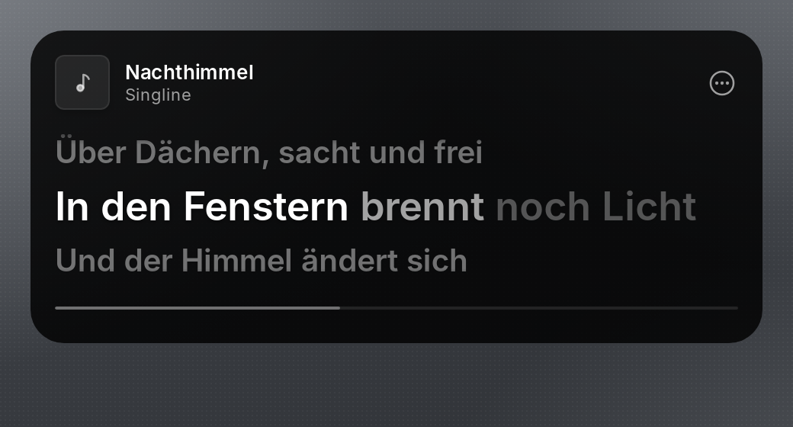
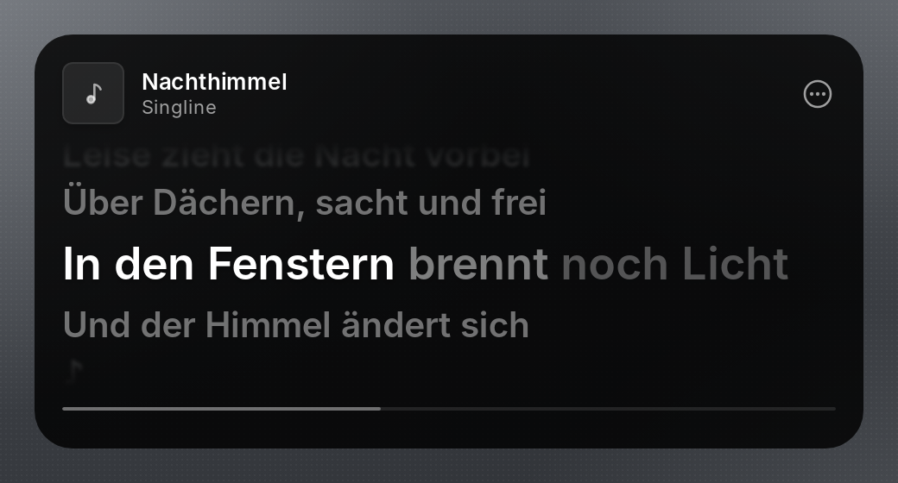
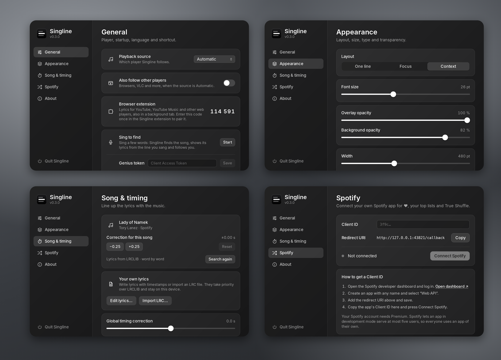

<div align="center">



# Singline

**Synced lyrics in a small window above everything else.**<br>
For Spotify, Apple Music, Amazon Music and music in your browser, on Windows, macOS and Linux.

[](https://github.com/JulianRudrich/LyricsOverlay/actions/workflows/ci.yml)
[](LICENSE)




</div>

> [!NOTE]
> Singline is in active development and has no stable release yet. Every change is tested on Linux with an automated end-to-end test, and every change on `main` produces test builds for Windows and macOS ([Install](#install)). The builds are not code-signed yet.

## Contents

[Features](#features) · [Supported players](#supported-players) · [Install](#install) · [Using Singline](#using-singline) · [Where the lyrics come from](#where-the-lyrics-come-from) · [Privacy](#privacy) · [Troubleshooting](#troubleshooting) · [Building from source](#building-from-source) · [Roadmap](#roadmap) · [Credits](#credits) · [License](#license)

## Features

- **Follows what you play.** Singline reads the song and the playback position from your music app. It needs no login and no API key, and it never starts a player by itself. Let it follow whichever player is playing, or pick one.
- **Word by word.** Every word lights up as it is sung, from real word timing where the lyrics have it and estimated from the line timing otherwise. Between two readings of the player the position keeps running, so the highlight moves smoothly.
- **Lyrics in motion.** The lines scroll up as the song goes on, the next line grows into place, and breaks show three breathing dots. A new song fades in with its cover, title and artist.
- **A mini-player on hover.** Previous, play/pause and next, a seek bar with elapsed and remaining time, and markers for the chorus. Click any line to jump there.
- **Three layouts.** One line, Focus or Context, with adjustable font size, opacity, background, width and height.
- **Stays out of your way.** The overlay floats above other windows on every desktop and never takes the focus. It can let clicks pass through to the window below, and Alt+Shift+L (⌥⇧L on macOS) shows or hides it. Drag it anywhere or send it to a corner.
- **Timing you can correct.** If the lyrics run early or late, move them by a quarter of a second; Singline remembers the correction for that song. A global correction makes up for your audio setup, for example Bluetooth headphones.
- **Finds the right version.** Exact matches first, then a search that prefers the same album and versions with word timing. Plain lyrics are spread over the song and marked *~ not synced*; instrumentals are recognised.
- **Your own lyrics.** Import an LRC file, or paste the lyrics into the editor and set each line's timestamp with a key press while the song plays. Your lyrics always win.
- **Your music.** Listening time, plays, your daily streak, skips, a listening clock, and your most played songs and artists, from every player, kept only on your device.
- **Sleep timer and auto-hide.** Pause the music after 15 to 60 minutes or at the end of the song, and let the overlay disappear while nothing plays.
- **Works offline.** Lyrics are cached on your device, so songs you have heard before work without a connection.
- **Private.** No account, no tracking, no analytics. Only the song's title, artist, album and duration leave your computer, to look up lyrics, and you can turn that off.
- **English and German**, following your system language.

| One line | Focus | Context |
|:-:|:-:|:-:|
|  |  |  |



## Supported players

| | Windows | macOS | Linux |
|---|---|---|---|
| **Spotify** | Desktop app | Desktop app | Desktop app |
| **Apple Music** | Apple Music app | Music app | Web player ¹ |
| **Amazon Music** | Desktop app ² | Planned ³ | Web player ¹ |
| **YouTube Music, YouTube and other web players** | Any browser ⁴ | Planned ³ | Any browser ⁴ |
| **Other media players** | Players that report to the system media controls ⁴ | – | Any MPRIS player, such as VLC ⁴ |

1. Recognised as Apple Music or Amazon Music when the browser shares the page address, as Firefox does. In other browsers the tab counts as a browser player (see ⁴).
2. Some versions of Amazon Music for Windows report only part of the song information.
3. macOS offers no public way to read these players. A browser extension that covers web players on every system is on the [roadmap](#roadmap).
4. Turn on **Also follow other players** in Settings → Song & timing. A tab keeps working in the background.

On Linux, Singline reads players through MPRIS, on Windows through the system media controls, and on macOS through AppleScript.

## Install

### Windows and macOS test builds

1. Open the [latest successful build of `main`](../../actions/workflows/ci.yml?query=branch%3Amain+is%3Asuccess) and choose the newest run. You need to be signed in to GitHub to download.
2. Under **Artifacts**, download **singline-Windows** (installer as `.exe` and `.msi`) or **singline-macOS** (a universal `.dmg` for Apple silicon and Intel Macs).
3. Install it. The builds are not signed yet:
   - **Windows:** if SmartScreen stops the installer, choose **More info** → **Run anyway**.
   - **macOS:** if macOS refuses to open the app, go to **System Settings → Privacy & Security** and choose **Open Anyway** (on macOS 14 and earlier, right-click the app and choose **Open**). When you play music, allow Singline to control Spotify or Music.

### Linux

Build Singline from source as described [below](#building-from-source). Packages (AppImage, .deb, Flatpak) are planned.

### The native macOS app

[`apps/macos`](apps/macos) contains the original macOS app, written in Swift, with the features contributed from Linory. It remains available until Singline has all of them on every system; what is still missing is the Spotify connection with True Shuffle. See its [README](apps/macos/README.md).

## Using Singline

Start Singline and play a song. Singline sits in the system tray (the menu bar on macOS) and shows the lyrics as soon as it finds them.

| To … | do this |
|---|---|
| Show or hide the overlay | Press **Alt+Shift+L** (**⌥⇧L** on macOS), or use the tray menu |
| Move the overlay | Drag it, or choose a corner in the tray menu under **Position** |
| Click the window behind the overlay | Turn on **Click-through** in the tray menu |
| Open the settings | Click the note in the overlay, or choose **Settings…** in the tray menu |
| Fix the timing of a song | Settings → Song & timing → **−0.25** / **+0.25** (remembered per song) |
| Fix the timing of all songs | Settings → Song & timing → **Global timing correction** |
| Choose the player to follow | Tray menu → **Playback source**, or Settings → Song & timing |
| Follow browsers and other players | Settings → Song & timing → **Also follow other players** |
| Control the player | Move the pointer over the overlay for previous, play/pause, next and the seek bar |
| Jump to a line or the chorus | Click the line, or a chorus marker on the seek bar |
| Add your own lyrics | Settings → Song & timing → **Import LRC…** or **Edit lyrics…** |
| Set a timestamp in the editor | Press **Ctrl+Shift+T** (**⌘⇧T** on macOS) while the line is sung |
| Pause the music later | Tray menu → **Sleep timer** |
| See your listening statistics | Tray menu → **Your music…** |
| Hide the overlay while nothing plays | Turn on **Hide when nothing is playing** in the settings |
| Search a song's lyrics again | Click the retry button that appears when a search fails |
| See Singline without playing music | Start it with `--demo` |

Positive corrections show the lyrics earlier, negative ones later. The global and the per-song correction add up.

## Where the lyrics come from

1. **Your own lyrics**, imported from an LRC file (UTF-8, up to 512 KB) or written in the editor. They are kept on your device and win over everything else.
2. **The local cache.** Lyrics found earlier are remembered, so they appear instantly and work offline.
3. **[LRCLIB](https://lrclib.net)**, a free, open lyrics database. Singline first asks for the exact recording (title, artist, album and a duration within a few seconds), then searches and prefers the same album and versions with word timing.

How often word timing is available varies by song. In a sample of ten popular songs on LRCLIB, eight had at least one version with word timing.

## Privacy

- Singline has no account, no telemetry and no analytics.
- The only network requests go to LRCLIB, sending the title, artist, album and duration of the song you are playing. Turn off **Search lyrics online** in Settings → Song & timing to keep everything on your device.
- Your listening history never leaves your device. Turn it off or clear it at the bottom of the **Your music** window; cleared entries are overwritten on disk.
- Your settings are stored in `settings.json`. The cache, your timing corrections, your own lyrics and your listening history are stored in `singline.sqlite`. Deleting these files resets Singline.

| System | Location |
|---|---|
| Windows | `%APPDATA%\io.github.julianrudrich.singline` |
| macOS | `~/Library/Application Support/io.github.julianrudrich.singline` |
| Linux | `~/.config/io.github.julianrudrich.singline` (settings) and `~/.local/share/io.github.julianrudrich.singline` (data) |

## Troubleshooting

**macOS says to allow access in System Settings.** Singline asks Spotify and Music for the current song through Apple Events. Turn on Singline under **System Settings → Privacy & Security → Automation**.

**The lyrics are early or late.** Correct the song with −0.25 / +0.25. If every song is off by the same amount, which is typical for Bluetooth headphones, use the global correction instead.

**No lyrics found.** LRCLIB does not know the song yet, or knows it only without timing. Click the retry button to search again later.

**The player does not report the playback position.** Without a position the lyrics cannot follow. This depends on the player; Singline tells you which one it is.

**Alt+Shift+L does nothing.** Another app already uses the shortcut, and Settings says so. Show or hide the overlay from the tray menu instead. On Linux the shortcut currently works on X11 only.

**The overlay does not stay on top on Linux (Wayland).** GNOME does not let apps keep normal windows on top under Wayland. Start Singline with `GDK_BACKEND=x11` so it runs through XWayland.

**Find out what your player reports.** `singline-watch` prints live what every player on your computer reports: title, artist, album, position, how far the position drifts, and which controls it offers. The Windows and macOS test builds include it; from source, run:

```bash
cargo run --release -p media-session --bin singline-watch
```

Please include its output when you [report a problem](../../issues/new).

## Building from source

You need Rust 1.85 or later, Node.js 22 and pnpm 10. On Linux you also need the WebKitGTK development files; on Debian and Ubuntu:

```bash
sudo apt install libwebkit2gtk-4.1-dev libgtk-3-dev libayatana-appindicator3-dev librsvg2-dev libxdo-dev
```

Install the dependencies:

```bash
pnpm install
```

Run Singline in development mode, with the interface reloading on every change:

```bash
pnpm dev
```

Build a debug version and start it with the built-in sample song:

```bash
pnpm --filter singline-desktop tauri build --debug --no-bundle
```

```bash
./target/debug/singline --demo
```

Build the installers for your system:

```bash
pnpm build
```

### Checks

Every change has to pass these checks, which CI runs as well:

```bash
cargo fmt --all --check
```

```bash
cargo clippy --workspace --all-targets -- -D warnings
```

```bash
pnpm --filter singline-desktop check
```

```bash
pnpm --filter singline-desktop test
```

```bash
cargo test --workspace
```

```bash
bash apps/desktop/e2e/linux-smoke.sh
```

`cargo test --workspace` needs the built interface (`pnpm --filter singline-desktop build`); a plain `cargo test` covers the crates only. The end-to-end check starts the app on a virtual display with a simulated Spotify and a simulated LRCLIB, and compares every line the overlay shows with the playback time.

### Environment variables for development

| Variable | Effect |
|---|---|
| `SINGLINE_DATA_DIR` | Keeps settings and data in this folder instead of the system location |
| `SINGLINE_LRCLIB_URL` | Uses another LRCLIB server, for example a local test server |
| `SINGLINE_DEBUG` | Makes the overlay report every line it shows, for end-to-end checks |

### Project structure

| Path | Contents |
|---|---|
| [`crates/lyrics-core`](crates/lyrics-core) | Lyrics logic without input or output: LRC and Lyricsfile parsing with word timing, matching, the playback clock, choosing a player |
| [`crates/media-session`](crates/media-session) | Reading and controlling players through MPRIS, the Windows media controls and AppleScript, plus `singline-watch` |
| [`crates/lyrics-providers`](crates/lyrics-providers) | The LRCLIB client and the SQLite store for your own lyrics, corrections and the cache |
| [`apps/desktop`](apps/desktop) | The Singline app: Tauri and Rust in `src-tauri`, the Svelte interface in `src`, the end-to-end test in `e2e` |
| [`apps/macos`](apps/macos) | The native macOS app in Swift |
| [`docs`](docs) | Roadmap, feature parity, test guide and measurements |

## Roadmap

**Done recently**

- Your own lyrics with LRC import and an editor with a timestamp key
- The mini-player with seek bar, chorus markers and jumping to a line, cover art, scrolling lines and an estimated word highlight
- Sleep timer, hiding the overlay while nothing plays, and listening statistics

**In progress**

- Settings in the glass design of the native macOS app
- Spotify connection for True Shuffle, liking songs and your top lists (requires Spotify Premium)
- Web players on every system, including YouTube Music in a background tab on macOS

**Later**

- Installers with automatic updates, signed builds, and packages for winget, Homebrew, Flathub and the AUR
- More lyrics sources, a choice between versions, an editor for word timing, and publishing your lyrics to LRCLIB
- A delay per audio output, translations, themes and a mode for streaming with OBS

The detailed plan is in [docs/ROADMAP.md](docs/ROADMAP.md), and [docs/PARITY.md](docs/PARITY.md) tracks every feature on every system.

## Credits

- [Mike Fox](https://github.com/MikeLeonFox) built Linory, a macOS fork of this project, and contributed all of its features back in [#1](../../pull/1). Singline brings them to every system.
- Lyrics come from [LRCLIB](https://lrclib.net), the open lyrics database created by [tranxuanthang](https://github.com/tranxuanthang) and filled by its community.
- Singline is built with [Tauri](https://tauri.app), [Rust](https://www.rust-lang.org) and [Svelte](https://svelte.dev).

## License

Singline is free software under the [GNU General Public License v3.0 or later](LICENSE). The native macOS app in [`apps/macos`](apps/macos) and releases up to 0.1.0 are available under the [MIT License](apps/macos/LICENSE).

Song lyrics belong to their rights holders. Singline is not affiliated with Spotify, Apple, Amazon, Google or LRCLIB.
